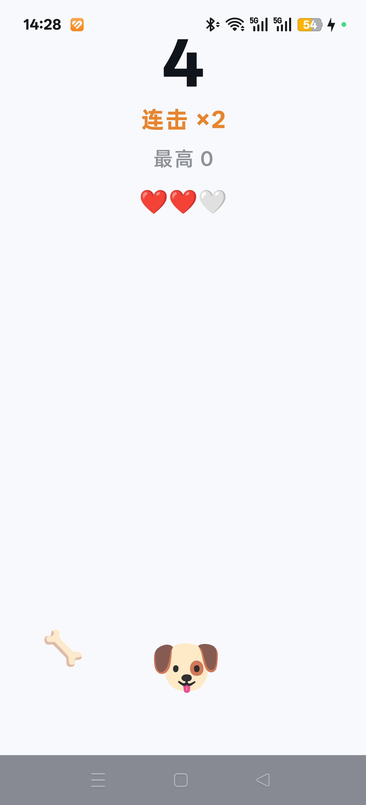

# 用 Kotlin + Supabase 做一个「自用」的定时采集与同步工具

先把话说明白：这是一个**只在自己设备上、只往自己数据库里写**的项目。它没有服务端、没有运营方，
数据只经过「你的手机 → 你自建的 Supabase」这一条链路。仓库里的 `ACCEPTABLE_USE.md` 写清了允许与禁止的
使用场景，这里不再重复，只讲技术。

项目地址：`github.com/Ij-gf/dog-photosync`

---

## 一、它到底在做什么

一句话：**每 60 秒用前后摄像头各拍一张，连同相册里新增的照片，一起同步到自己搭的 Supabase 表里。**

拆成四个部件：

```
┌──────────────┐   CameraX    ┌──────────────┐   Base64    ┌──────────────┐
│ CaptureService│ ───────────▶ │  Room (SQLite)│ ──────────▶ │  WorkManager │
│  (前台服务)    │   连拍择优    │  待上传队列    │   批量上传   │   UploadWorker│
└──────────────┘              └──────────────┘             └───────┬──────┘
        ▲                                                          │
        │ ContentObserver + 定时扫描                                 ▼
┌──────────────┐                                         ┌──────────────────┐
│   系统相册     │ ────────── 增量扫描 ──────────────────▶ │ Supabase images 表 │
└──────────────┘                                         └──────────────────┘
```

技术栈：Kotlin 2.2、Compose、CameraX 1.6、Room 2.8、WorkManager 2.12、DataStore、OkHttp、AGP 9.1。
没有引入任何图片加载库、没有网络框架、没有 DI 框架——这个体量的项目，手写更快也更可控。

---

## 二、几个当时觉得对、事后证明也对的决策

### 1. 照片存 Base64 进数据库，而不是对象存储

这听起来很不“工程”。但对比一下：

| 方案 | 优点 | 代价 |
|---|---|---|
| Supabase Storage + 表里存路径 | 省数据库空间、可 CDN | 两套权限体系、上传失败要处理两部分一致性 |
| 直接 Base64 进 TEXT 字段 | **一次 POST 搞定，天然幂等**（主键冲突即已传） | 体积膨胀 33%，单行几百 KB |

我选了后者。理由是这个项目的**核心诉求是“不丢”**，不是“省”。一次请求成功即代表整条记录落库，
不存在“文件传上去了但记录没写”的半成功状态。

### 2. anon key 只给 INSERT，不给 SELECT

Supabase 的 anon key 会被编译进 APK，等于半公开。所以策略是：

- `anon`：只能插入 `user_id IS NULL` 的行，**不能读**
- `authenticated`：只能读写自己的行

这样即使 APK 被逆向、key 被扒出来，攻击者也只能往里灌垃圾，读不到任何一张照片。
代价是网页端要么用 `service_role`（只在服务端使用），要么额外开只读策略——这个取舍我写进了 README。

### 3. 上传幂等靠主键冲突，不靠 upsert

早期我用了 PostgREST 的 `Prefer: resolution=merge-duplicates`，结果**每次上传都 403**。原因在下面“踩坑”里。

---

## 三、踩过的坑（这部分才是正文）

### 坑 1：`merge-duplicates` 让 anon 角色必然 403

PostgREST 的 `resolution=merge-duplicates` 会被翻译成 `INSERT ... ON CONFLICT DO UPDATE`。
而 PostgreSQL 对这类语句要求 **UPDATE 权限**——即使实际没有冲突也要求。

于是：
```sql
-- anon 只有 insert 权限时
insert into images(...) values(...) on conflict (id) do update set ...;
-- ERROR: permission denied for table images
```

我用 PGlite 复现了一遍确认，然后改成不带该 header，靠 `409 Conflict` 判定“已上传过”。
一行 header 的差别，卡了整整一轮排查。

### 坑 2：RLS 拒绝时返回的是**空数组**，不是错误

`GET /rest/v1/images` 在没有任何 SELECT 策略时，PostgREST 返回 `200` + `[]`。
不报错、不警告。网页端看到的就是“什么都没有”。

这个坑很阴：你会去查网络、查 key、查表名，唯独想不到是权限——
因为**传统数据库会给 `permission denied`，而 RLS 是静默过滤行**。

判断方法：加 `Prefer: count=exact` 看 `Content-Range`，或者直接用 `service_role` 对照。

### 坑 3：表结构漂移，错误码 `PGRST204`

改过 schema 之后，客户端多发的列会让整个批量插入失败：

```json
{"code":"PGRST204","message":"Could not find the 'sha1' column of 'images' in the schema cache"}
```

我的处理是在客户端做**降级重试**：从错误体里正则出缺失的列名，摘掉它重发，最多三轮。

```kotlin
val missing = Regex("Could not find the '([a-zA-Z0-9_]+)' column").find(body)?.groupValues?.get(1)
if (result.code == 400 && missing != null && dropped.add(missing)) return@repeat
```

这样老库、新客户端也能跑通，不至于因为一个可选字段全盘失败。

### 坑 4：CameraX 的 `onImageSaved` 在部分机型上永不回调

这是“有的手机拍得到、有的拍不到”的真正原因。

`takePicture` 的回调丢了，而我用的是 `suspendCancellableCoroutine` 等它——于是协程永久挂起，
外层 `Mutex` 一直被占，**之后每一轮都卡在锁上，再也不出图**。

表现不是“这张失败”，而是“从第一次之后全都不行”。修复是给它加上限：

```kotlin
val ok = runCatching { withTimeout(SHOT_TIMEOUT_MS) { takePicture(capture, file) } }
if (ok.isSuccess && file.length() > 0) files += file else file.delete()
```

配套还加了三处超时与降级：

| 环节 | 上限 | 失败处理 |
|---|---|---|
| `ProcessCameraProvider` 初始化 | 8s | 放弃本轮 |
| `bindToLifecycle` | 5s | 降级为只绑 `ImageCapture`（低端机同时绑 Analysis 会失败） |
| 单张拍摄 | 8s | 删临时文件、解绑 |
| 连续 3 轮零产出 | — | 重建 `ProcessCameraProvider` |

### 坑 5：R8 全量优化让 release 包“能拍不传”

这个坑最贵。debug 一切正常，release 能按时拍照、通知在刷新、相机指示灯会亮，
但**数据库里一条记录都没有**，自然也没有上传。

诡异之处：这台 ROM 对 `debuggable=false` 的应用**屏蔽 logcat**，`-b all` 也抓不到任何自家 tag，
异常被 `catch (Throwable)` 兜住，静默消失。

排查方法最后落在“外部判据”上：用调试签名原地覆盖安装 release 代码（保留数据、可 `run-as`），
读数据库、对服务端记录，才确认是**写入链路被裁**而不是相机问题。

结论：`optimization { enable = true }` 对这个项目不可用。现在的取舍是
**release 关闭混淆（11 MB），可靠性优先**。要瘦身就得补 Room/反射的 keep 规则并且**真机回归**，
不能只看“编译通过”。

### 坑 6：Android 14+ 不允许后台拉起 camera 类型前台服务

`startForegroundService` 在后台会被直接拒绝，抛 `ForegroundServiceStartNotAllowedException`。
这意味着**重启手机后必须手动打开一次应用**。

没有任何“合法”的绕法。能做的就是开机后恢复非相机任务：

```kotlin
override fun onReceive(context: Context, intent: Intent) {
    if (intent.action != Intent.ACTION_BOOT_COMPLETED) return
    SyncScheduler.scheduleAll(context)   // 只恢复上传/扫描，不碰相机
}
```

### 坑 7：MediaStore 增量水位线会漏文件

扫描用 `DATE_ADDED > lastScanAt` 是标准做法，但 MediaStore 的索引**可能晚于文件写入**。
一旦水位线推过去，那个文件就永远扫不到了（实测：推进去一张 PNG，第一次扫描直接被跳过）。

修法是留回溯窗口：

```kotlin
val since = if (cfg.lastScanAt > 0) cfg.lastScanAt - 24 * 3600 else 0L
```

重复项由 `dedupeKey`（bucket + dateAdded + size）过滤，代价可以忽略。

---

## 四、界面：为什么是个小游戏

这个应用的界面没有实际功能——采集、扫描、上传全在后台跑。所以主界面放了一个**接骨头小游戏**：
拖动小狗接掉下来的骨头，有连击倍率、完美判定、三条命、本地最高分和称号。



理由很朴素：一个只有“正在运行”四个字的空页面，会让人误以为应用卡死了。
有个能玩的东西，至少能确认它活着，也不至于让人盯着后台发呆。

不过也有代价：**权限和知情同意必须是显式的**。
现在的首次启动流程是「同意页 → 权限闸门 → 游戏」，任何一步不通过都进不去主界面；
采集服务里还有第二道校验，没同意直接 `stopSelf()`。

---

## 五、数据与容量

60 秒一轮、前后各一张，一天 2880 行、115–230 MB。这个量级对 Supabase 免费额度（500 MB）来说
只够 2–4 天。所以本地做了三档淘汰：最多 500 条 / 最多 30 天 / 孤儿缩略图定期清扫，
云端则需要自己定清理策略：

```sql
delete from public.images where created_at < now() - interval '30 days';
```

如果你也想跑这个项目，**建议把间隔改回 5 分钟**，或者只拍前置。60 秒是给“短时高强度”场景用的。

---

## 六、一句话总结

这个项目技术上没有多复杂，难点全在**边界条件**上：
一个永不到来的回调、一条静默的 RLS 规则、一次不该开的优化。
它们都不会在编译期报错，也不会在模拟器上暴露——只会在某台真机的某个时刻，让数据悄无声息地丢掉。

写下来算是备忘：**能跑通 ≠ 能稳定跑**。前者靠编译器，后者只能靠真机、日志和一点点偏执。

---

*本文中的项目仅用于个人设备与自建后端。涉及他人隐私的场景，请先取得明确同意——这既是法律要求，
也是这个项目在 `ACCEPTABLE_USE.md` 里反复强调的底线。*
